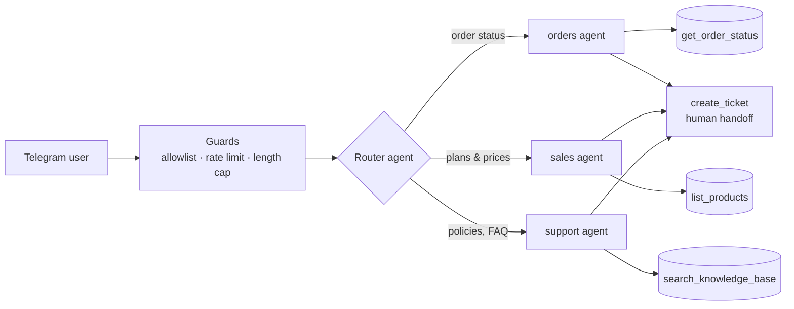

# Multi-Agent AI Support Bot for Telegram

[](https://github.com/matasobotka-tech/multi-agent-telegram-bot/actions/workflows/tests.yml)


A production-style Python Telegram bot where a **router agent** sends each customer message to one of
three **specialist agents**, each with its own tools. Agents answer only from tool data, so they never
invent orders, prices or policies.



| Agent | Tools | Handles |
|---|---|---|
| `orders` | `get_order_status`, `create_ticket` | order status, tracking, ETA |
| `sales` | `list_products`, `create_ticket` | plans, prices, recommendations |
| `support` | `search_knowledge_base`, `create_ticket` | shipping, returns, payment, hours |

## Features
- **Claude tool use** with strict JSON schemas; tool errors are fed back to the model instead of crashing; tool-loop limit
- **Per-chat memory** (last 6 turns), `/reset`, and `/human` handoff that creates a ticket
- **Non-blocking**: LLM calls run off the event loop, so many chats stay responsive
- **Replies in the customer's language**, short and concrete
- **18 unit tests** with a fake LLM client - no API key needed; CI on Python 3.11-3.13
- **Docker image** running as a non-root user

## Security
| Risk | Mitigation |
|---|---|
| Bot token leaking into logs | request-URL logging of `httpx` is silenced (Telegram URLs contain the token) - covered by a test |
| Secrets in the repo or image | `.env` is git- and docker-ignored; config only from environment variables |
| Spam / cost abuse | per-chat rate limit (8 msg/min), 1500-character input cap, optional `ALLOWED_CHAT_IDS` allowlist |
| Prompt injection | customer text is wrapped as data; agents are told to ignore role-change requests; router output is validated against a fixed list |
| Hallucinated answers | agents may answer only from tool results; unknown order ids return an explicit error |
| Crashes leaking internals | exceptions are logged server-side, the user gets a generic message |

## Run locally
```bash
python -m venv .venv
source .venv/bin/activate          # Windows: .venv\Scripts\Activate.ps1
pip install -r requirements.txt
cp .env.example .env               # Windows: Copy-Item .env.example .env
# fill in TELEGRAM_BOT_TOKEN and ANTHROPIC_API_KEY
python -m bot.main
```
Try: "where is my order 1001?", "which plan is best for a team of 5?", "how do returns work?", `/human`.
The console shows which agent handled each message (`agent=orders`, `agent=sales`, ...).

## Run with Docker
```bash
docker build -t multi-agent-bot .
docker run --env-file .env --restart unless-stopped multi-agent-bot
```

## Tests
```bash
python -m unittest -v
```

## Configuration
| Variable | Required | Meaning |
|---|---|---|
| `TELEGRAM_BOT_TOKEN` | yes | token from @BotFather |
| `ANTHROPIC_API_KEY` | yes | Anthropic API key |
| `ALLOWED_CHAT_IDS` | no | comma-separated chat ids allowed to use the bot |
| `BOT_MODEL` | no | Claude model id (default `claude-opus-5-5`) |

## Adapting it to a real business
Demo data (orders, products, knowledge base) lives in `bot/agents.py`. In production each tool calls the
shop's database, CMS or API instead; adding an agent is one `Agent(...)` entry plus a line in the router prompt.

---
Developed AI-assisted (Claude Code), reviewed and tested by hand.
